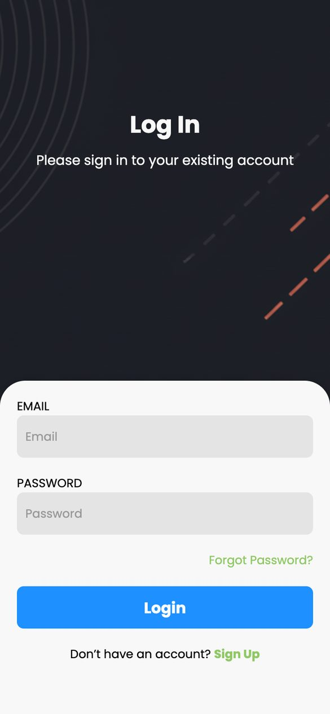
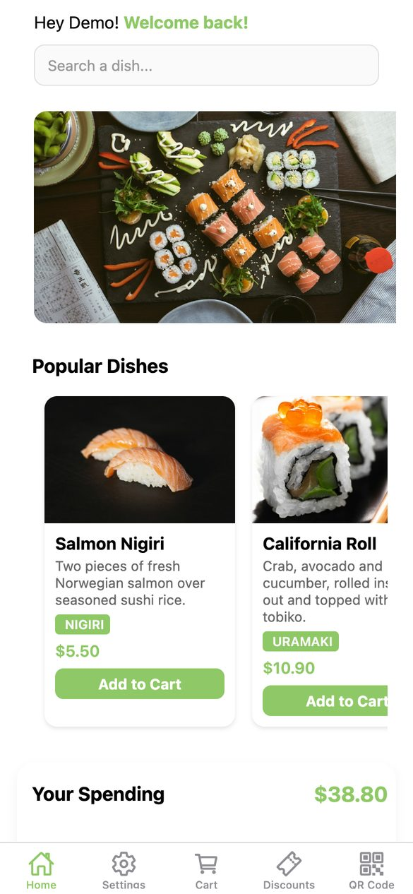
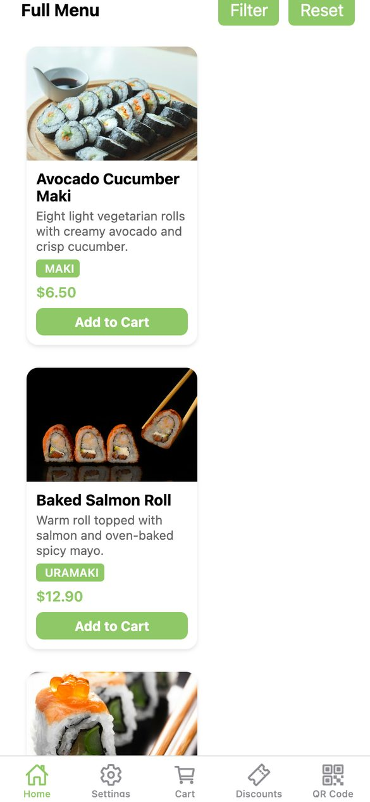
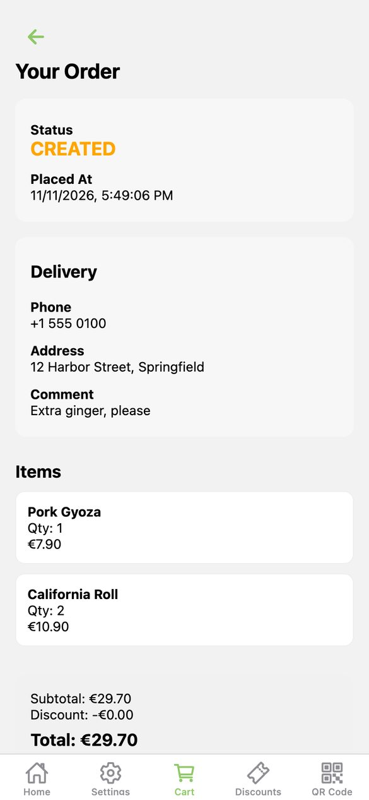
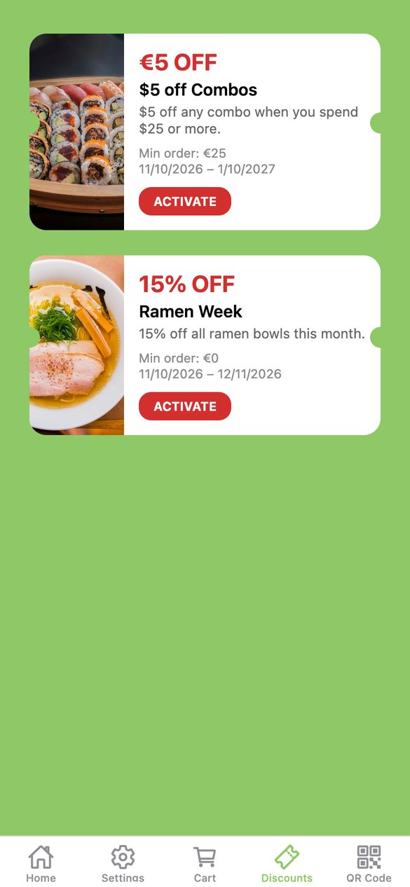
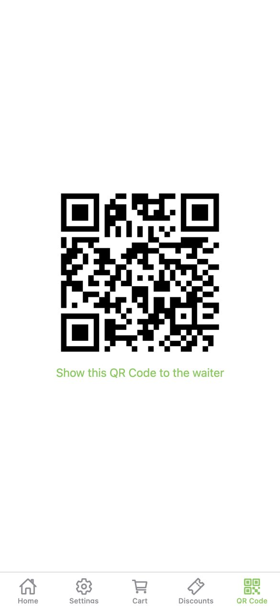
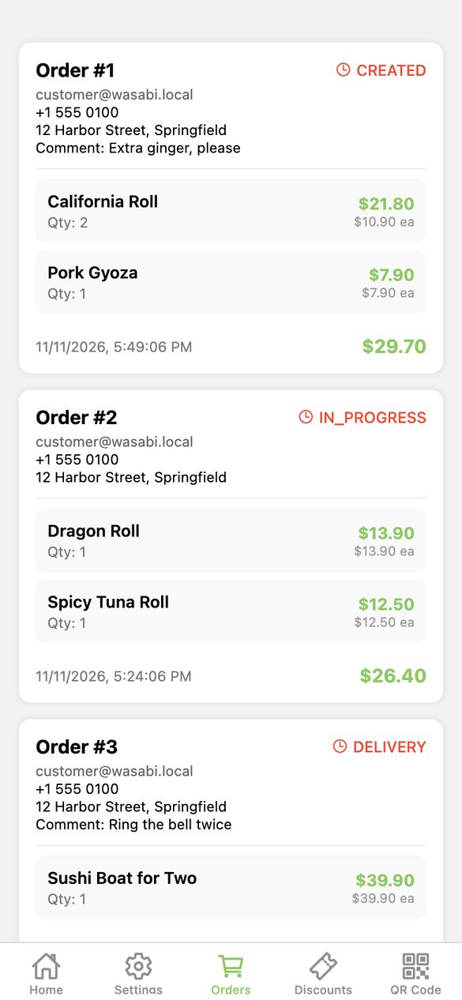
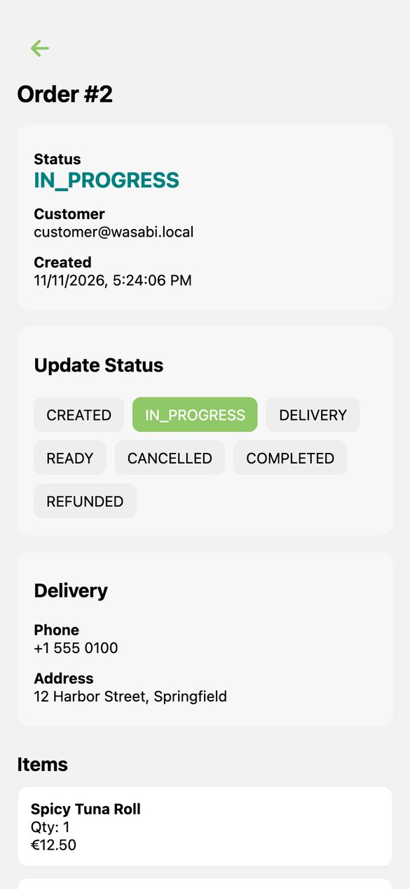
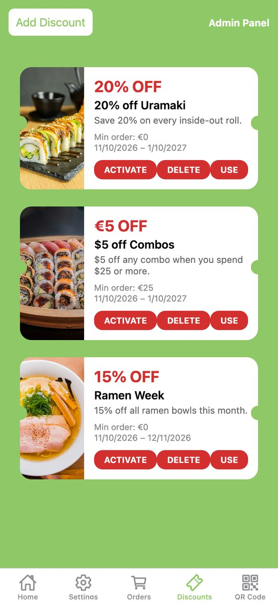
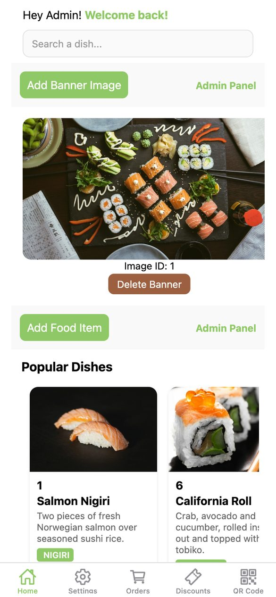

# 🍣 Wasabi Sushi App – Frontend (React Native + Expo)

The **mobile app** for Wasabi Sushi, built with **React Native** and **Expo**.
Customers browse the menu, order, track their orders, collect discounts and show a personal loyalty QR code. Admins manage orders, the menu, banners and discounts from the same app.

The API lives in **[wasabi-backend](https://github.com/Olti1947/wasabi-backend)**.

---

## 📸 Screenshots

### Customer

| Login | Home | Full menu |
| :---: | :---: | :---: |
|  |  |  |

| Order tracking | Discounts | Loyalty QR code |
| :---: | :---: | :---: |
|  |  |  |

### Admin

| Incoming orders | Order details | Manage discounts | Manage menu & banners |
| :---: | :---: | :---: | :---: |
|  |  |  |  |

---

## ✨ Features

- 📱 **Cross-platform**: Android, iOS and web via Expo
- 🔐 **Authentication**: JWT login and registration with automatic token refresh
- 🛒 **Menu & ordering**: popular dishes, full menu with category filters, cart and checkout
- 📦 **Order tracking**: live order status from created to delivered
- 🎟️ **Discounts & loyalty**: activate discounts and show a personal QR code to collect spending
- 🧑‍🍳 **Admin tools**: update order status, scan customer QR codes, manage food items, banners and discounts
- 🔔 **Push notifications** (Expo + Firebase, development build only)

---

## 🏗️ Tech Stack

- **React Native + Expo** (SDK 54) with **Expo Router**
- **Redux Toolkit** + **redux-persist** for state
- **Axios** for API calls
- **Formik + Yup** for forms
- **Expo Camera**, **Expo Notifications**, **Expo Image Picker**

---

## 🚀 Running it locally

You need the backend running first, then the app.

### 1. Start the backend

Follow the [wasabi-backend README](https://github.com/Olti1947/wasabi-backend#getting-started). In short, with **Java 17+** and **Docker** installed:

```bash
git clone https://github.com/Olti1947/wasabi-backend.git
cd wasabi-backend
cp .env.example .env          # then set JWT_SECRET to the output of: openssl rand -base64 32
docker compose up -d --wait
./mvnw spring-boot:run
```

On first start the backend fills the database with a demo menu, discounts and orders, and creates two accounts:

| Role | Email | Password |
| --- | --- | --- |
| Customer | `customer@wasabi.local` | `customer123` |
| Admin | `admin@wasabi.local` | `admin123` |

### 2. Start the app

You need **Node.js 20.19.4 or newer** (`.nvmrc` pins Node 22).

```bash
git clone https://github.com/Olti1947/wasabi-client.git
cd wasabi-client
nvm install && nvm use        # or install Node 22 another way
npm ci
npm start
```

Then pick where to run it:

- **Web browser:** press `w`. This is the quickest way to try it.
- **Phone with Expo Go:** press `s` to switch to Expo Go, then scan the QR code. Your phone must be on the same Wi-Fi as your computer. Push notifications don't work in Expo Go.
- **Development build:** `npm run android` / `npm run ios` builds and installs the native app (needs Android Studio or Xcode).

### Backend URL

The app reaches the backend at `http://<your computer's LAN IP>:8080`. `app.config.js` detects that IP automatically, so phones and emulators on your network can connect.
To use a different backend, create `.env.local` with:

```
API_URL=http://192.168.1.50:8080
```

Restart `npm start` after changing it.

---

## 🧰 Useful commands

```bash
npm start          # start the Expo dev server
npm run web        # start straight in the browser
npm run lint       # lint the project
```
